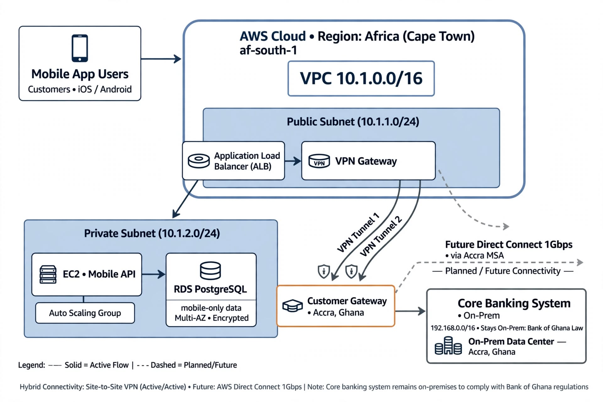
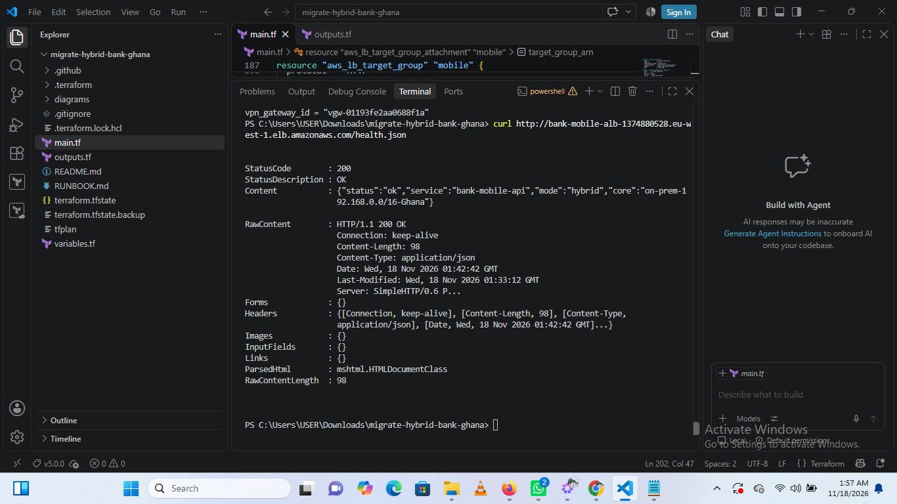

# Project - Migrate Hybrid Bank Ghana

## The Story 
A bank in Ghana has its core banking computer locked inside its building in Accra.
Bank of Ghana law says: that core computer MUST stay in Ghana, on-prem, on `192.168.0.0/16`.

But customers want a mobile app that works fast, anytime.

So we do Hybrid:
- **Keep** core banking on-prem in Ghana
- **Build** mobile app on AWS
- **Connect** them with a private tunnel (VPN), like a private road - not the public internet.

No data leaves Ghana for core. Mobile talks to core privately.

## The Architecture 
- **On-prem (simulated):** 192.168.0.0/16 - Core Banking System (stays)
- **AWS VPC:** 10.1.0.0/16 in eu-west-1 - Mobile App only
- **Connectivity:** Site-to-Site VPN, 2 tunnels (active/standby) + BGP
- **Future:** Direct Connect 1Gbps via Accra MSA (documented, not provisioned in demo - costs $$$)
- **AWS Compute:** EKS for mobile API, ALB public, private subnets for app/DB
- **AWS Data:** RDS PostgreSQL for mobile-only data (sessions, notifications, device). NO core data in AWS.
- **Security:** KMS, Secrets Manager, Security Groups deny-all by default, VPN encryption, CloudWatch + VPC Flow Logs

## What Success Looks Like
1. `terraform apply` succeeds
2. VPN shows UP (2 tunnels)
3. From AWS private subnet, you can reach on-prem 192.168.x.x via VPN only
4. Mobile API returns 200 via ALB
5. `terraform destroy` cleans everything - $0 left running

## Cost (Demo)
~ $3-$8 for a 1-2 hour demo if you destroy. Do NOT leave EKS + NAT + VPN running overnight.
DX 1Gbps is NOT in terraform - real DX is ~$300+/mo + cross-connect, we only document it.

